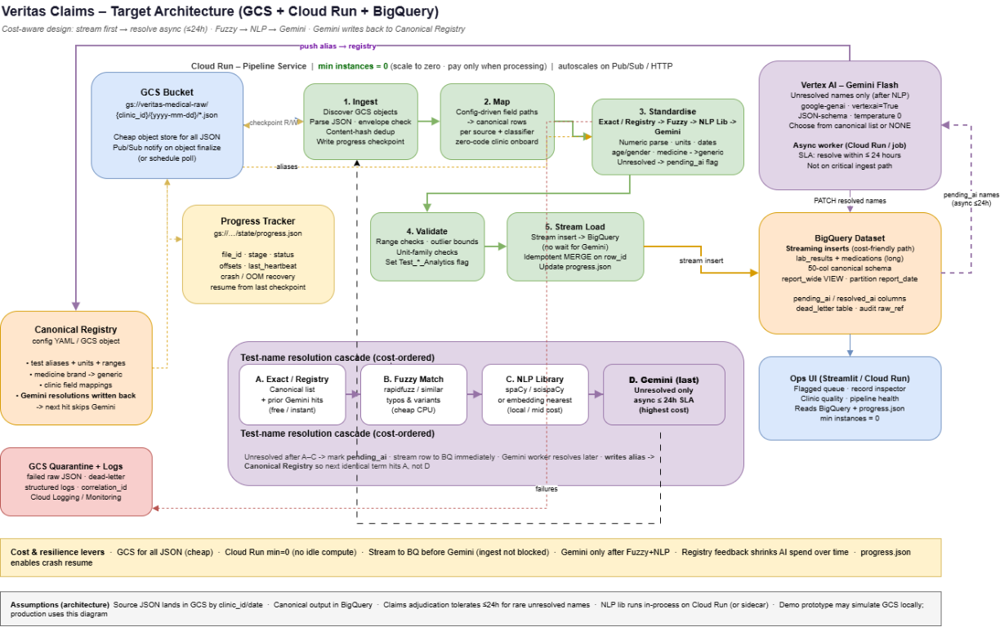

# Veritas Claims — Medical Data Standardisation

End-to-end prototype that ingests multi-clinic medical JSON, standardises lab/discharge data into a canonical schema, validates results, and loads an analytics store — with an ops UI.

**Architecture:** stream-first, resolve-async (GCS → Cloud Run pipeline → BigQuery; Gemini last-resort async).  
**Laptop / on-prem:** local folder → same pipeline → SQLite + Streamlit (default).



## Quick start (laptop)

```powershell
cd "D:\Niveus\veritas claims demo"
python -m venv .venv
.\.venv\Scripts\Activate.ps1
pip install -r requirements.txt
copy .env.example .env

# Run pipeline on sample-data/
python scripts\run_pipeline.py

# Ops UI
streamlit run src\veritas\ui\app.py

# Tests
pytest -q
```

Sample inputs live under `sample-data/{clinic_id}/{yyyy-mm-dd}/*.json` (copied from the assignment pack).

## Repository layout

```
config/           # clinic field maps + canonical registries (zero-code onboarding)
sample-data/      # input JSONs simulating GCS layout
src/veritas/      # pipeline, resolution cascade, storage, UI, API
scripts/          # CLI runners
docker/           # Cloud Run images (pipeline, UI, AI worker)
deploy/           # GCP bootstrap scripts
docs/             # architecture + assumptions
tests/
```

## Pipeline stages

1. **Ingest** — discover JSON, envelope checks, content-hash dedupe, `state/progress.json` checkpoints  
2. **Map** — clinic YAML field paths → rows  
3. **Standardise** — test-name cascade, numeric/unit/date/gender/medicine  
4. **Validate** — range / outlier / Invalid → `test_analytics`  
5. **Stream load** — idempotent upsert on `row_id` (does not wait for Gemini)

### Test-name cascade (cost-ordered)

Exact registry → `rapidfuzz` → NLP token similarity → Gemini (`pending_ai`, async ≤24h) with registry feedback.

## Live GCP deployment (project `veritas-claims-512706`)

| Service | URL |
|---------|-----|
| Pipeline API | https://veritas-pipeline-233971633808.us-central1.run.app |
| Ops UI | https://veritas-ops-ui-233971633808.us-central1.run.app |
| GCS raw | `gs://veritas-medical-raw-veritas-claims-512706/` |
| BigQuery | `veritas-claims-512706.veritas_claims_demo.canonical_records` |

```powershell
# Preferred
curl.exe -X POST "https://veritas-pipeline-233971633808.us-central1.run.app/run" `
  -H "Authorization: Bearer $(gcloud auth print-identity-token)" `
  -H "Content-Type: application/json" -d "{}"

# Cloud Run Console "Test" panel (POST /) also works — body may be {"name":"Developer"}
curl.exe -X POST "https://veritas-pipeline-233971633808.us-central1.run.app/" `
  -H "Authorization: Bearer $(gcloud auth print-identity-token)" `
  -H "Content-Type: application/json" `
  -d "{\"name\": \"Developer\"}"
```

`files_ok: 0` with `files_total: 5` usually means samples already completed (idempotent). Clear `gs://…/state/progress.json` to force a full reprocess.

Verified cloud run: **5 files → 442 rows** (362 lab / 74 medication / 6 discharge).

### Re-deploy from scratch

```powershell
$env:PROJECT_ID = "veritas-claims-512706"
.\deploy\setup_gcp.ps1
```

| Credential | Purpose |
|------------|---------|
| Active `gcloud` account (already used) | Deploy / GCS / BQ |
| Optional: `GEMINI_ENABLED=true` + Vertex AI | Async name resolution worker |

Set `STORAGE_BACKEND=gcp` in `.env` to run the same code against cloud from your laptop.

## Adding a clinic (no code)

1. Copy `config/clinics/default.yaml` → `config/clinics/NEWSOURCE.yaml`  
2. Adjust JSON field paths / `skip_test_names`  
3. Drop files under `sample-data/clinic_xxx/yyyy-mm-dd/` (or GCS equivalent)  
4. Extend `config/registry/test_names.yaml` / `medicines.yaml` as needed  

## Design decisions (short)

- **Long/narrow warehouse table** matching the assignment ideal schema; wide “5 cols per test” is a reporting view concern.  
- **Gemini async** keeps stream path fast; registry write-back shrinks AI spend.  
- **One `RecordStore` / `ObjectStore` interface** so laptop and GCP share pipeline code.  

## Known limitations

- spaCy model not required; Tier C uses Jaccard unless spaCy is installed.  
- Gemini off by default — unresolved names stay `pending_ai`.  
- Not load-tested to 200k/day (architecture scales via Cloud Run; see `docs/assumptions.md`).  
- Medicine map covers sample brands only.

## Docs

- [Architecture narrative](docs/architecture.md)  
- [Assumptions](docs/assumptions.md)  
- Assignment FR/NFR coverage is implemented in code under `src/veritas/` with configs under `config/`.
